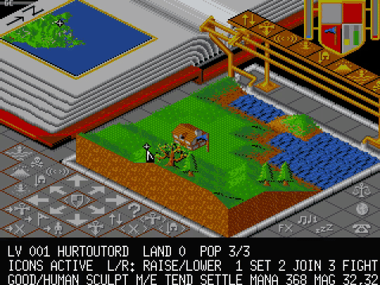
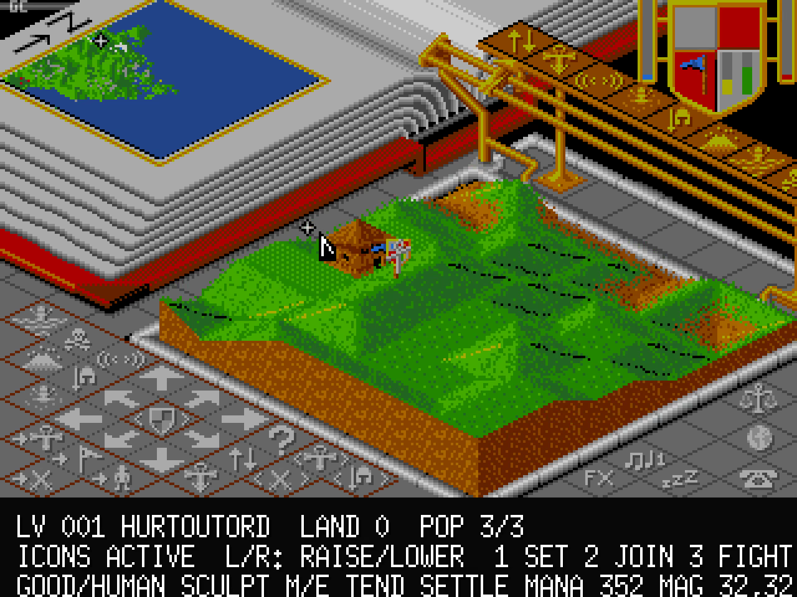
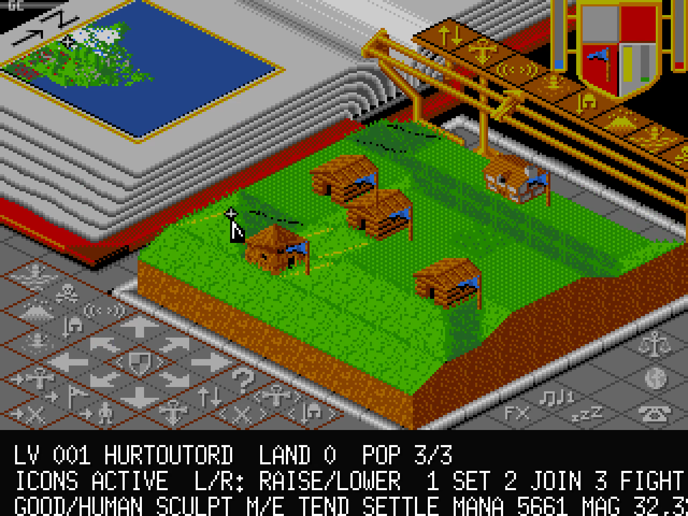
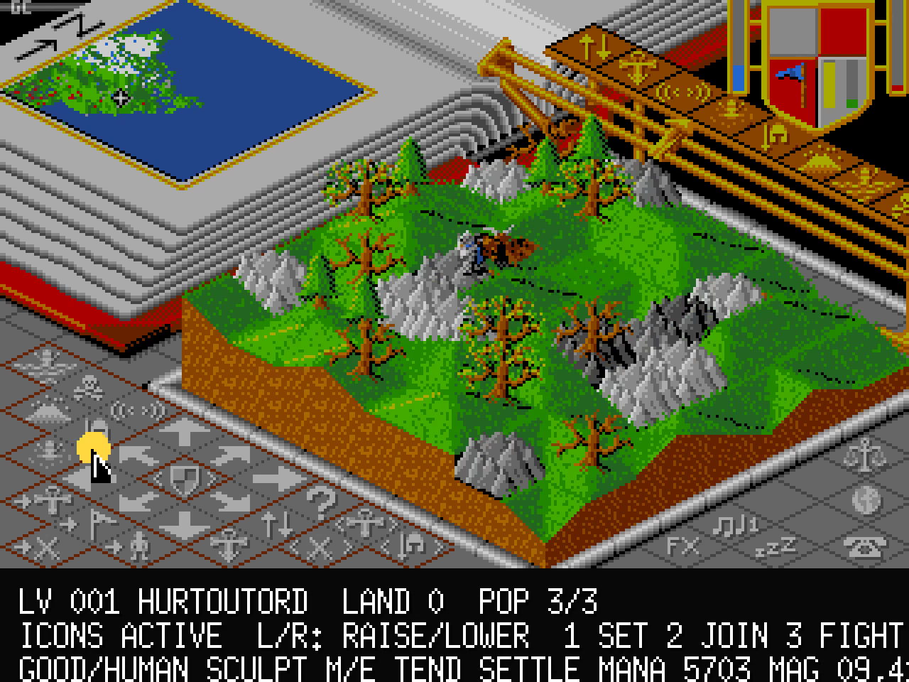
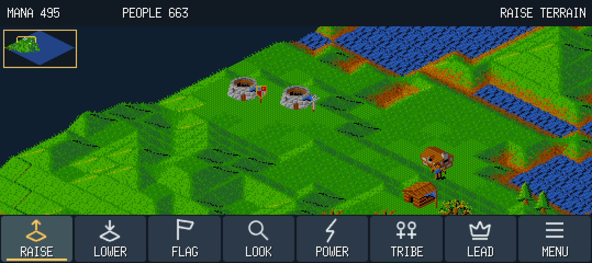

# Populous Go

A native Go/Ebitengine remake of Bullfrog's **Populous** for desktop and
Android. Shape the land, grow settlements, gather mana and defeat the opposing
deity across the original campaign worlds.



[Watch the 27-second MP4 preview](media/preview.mp4) or
[open the desktop and Android presentations on Malakh Software](https://www.malakhsoftware.com/games.html#go-populous).

| Coastal settlement | Village growth | Mountain terrain |
| --- | --- | --- |
|  |  |  |



## Features

- Isometric 64 × 64 world simulation with four terrain sets.
- Terrain sculpting, settlements, followers, knights, battles and victory rules.
- Earthquake, swamp, knight, volcano, flood and Armageddon powers.
- Original 495-world campaign, conquest, tutorial, custom games and saves.
- Two-player deterministic TCP multiplayer.
- Secure Bluetooth Classic multiplayer between two Android devices.
- AI-versus-AI attract mode with two spectator cameras.
- Original graphics, music, effects and speech generated from a user-supplied ADF.

## Prepare the resources

The original game data is not included. Follow
[the asset setup guide](docs/ASSET_SETUP.md), then run:

```sh
sh tools/exclude-local-assets.sh
./scripts/prepare-assets.sh -adf "/path/to/Populous.adf"
go run ./cmd/populous
```

Go 1.25 or newer and the normal Ebitengine platform prerequisites are required.

## Desktop commands

```sh
go run ./cmd/populous
go run ./cmd/populous -demo
go run ./cmd/populous -mobile-ui -width 1212 -height 540
go build -o bin/populous ./cmd/populous
```

After 30 seconds without title-screen input, a separate AI-versus-AI match
starts automatically. Any key, click or touch returns to the menu. Use
`-demo-delay 0` to disable the timer, `-demo-world` to select a campaign world
and `-demo-seed` to reproduce the shuffled order.

## Controls

| Input | Action |
| --- | --- |
| Left click | Raise land or activate the selected command |
| Right click | Lower land or cancel a selection |
| Drag / arrow keys | Move the world view |
| Original panel icons | Choose terrain tools and divine powers |
| 1–4 | Select common follower commands |
| F3 on the title | Start demonstration mode immediately |
| Space | Pause or resume |
| Escape | Close a menu or return to the title |
| M | Toggle audio |
| F11 | Toggle fullscreen |

The original minimap, population and mana gauges, terrain controls and power
icons remain active. Multiplayer peers exchange deterministic commands and can
resynchronize from a state snapshot.

## Android

Prepare the assets, connect one authorized Android device, then run:

```sh
./scripts/run-android.sh
```

Android uses a wide terrain view, compact minimap, large touch tools and power
panels. Two-finger dragging pans the camera. Bluetooth sessions use the same
lockstep game protocol without an Internet server.

## Original game credits and license

Populous was created by Bullfrog Productions and published by Electronic Arts
in 1989. Its original name, program, graphics, music, audio and game data remain
the property of their respective copyright holders. This independent fan remake
is not affiliated with or endorsed by the original rights holders.

The remake source is distributed under the terms in [LICENSE](LICENSE).

